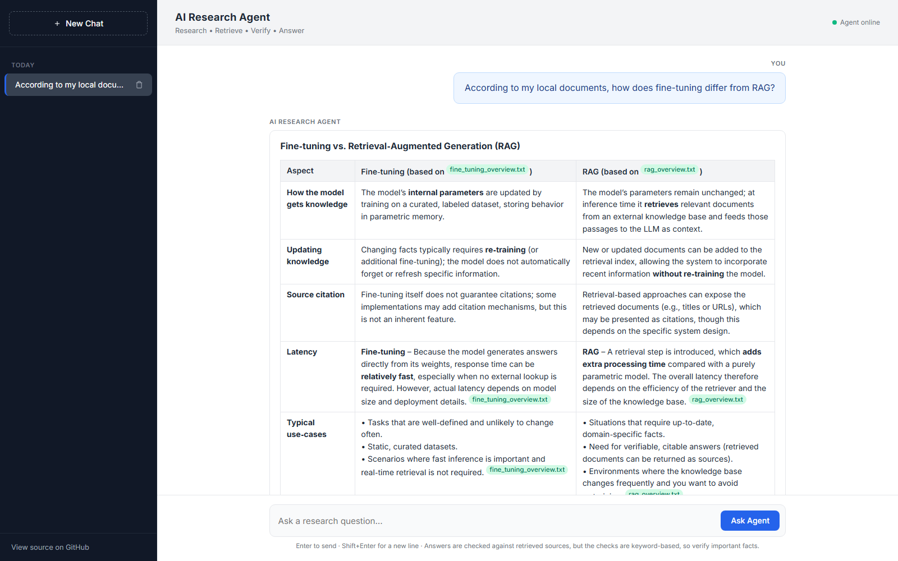
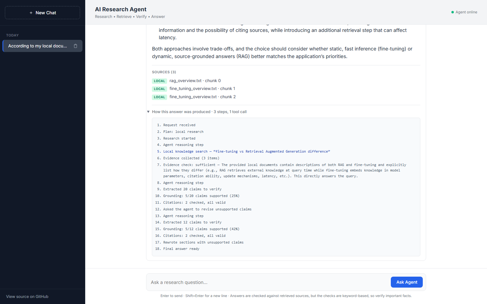

# AI Research Agent


> **An autonomous research agent that gathers evidence from live web search and a local vector database, then checks every claim and citation in its answer against that evidence before returning it.**

**Live demo:** https://ai-research-agent-sj1r.onrender.com/ &nbsp;·&nbsp; (free tier: the first request after idle can take 30–60 s)



<details>
<summary><b>See how the answer was verified</b>: sources and the execution trace</summary>

<br>



</details>

---

## Why this project?

LLMs write confident prose that mixes retrieved facts with things they "remember" or invent. Plain RAG helps, but it does not check the output. This project treats **post-generation grounding** as an engineering problem: the agent does not stop at producing an answer, it **inspects** it.

- Every factual claim is extracted and scored against the retrieved evidence.
- Every `[WEB: …]` / `[LOCAL: …]` citation is checked against the sources that were actually retrieved.
- Sections with unsupported or conflicting claims are rewritten; well-supported sections are left alone.

The pipeline avoids black-box RAG frameworks so that every decision is observable in the execution trace and covered by offline tests.

---

## How a question is answered

```text
User question
   │
   ├─ simple factual? ──► fast path (direct LLM answer)
   │
   ▼
Research plan (deterministic intent classification)
   ▼
Agent loop (LangGraph) ── LLM chooses tools ──► web search · local RAG · calculator
   ▼
Evidence collection  ──►  Reflection: "is this evidence sufficient?" (LLM-as-judge)
   │                          │ insufficient → refine search (bounded)
   │                          │ limit reached → forced synthesis
   ▼
Answer synthesis with citations
   ▼
Quality check: claim extraction → claim/evidence overlap → conflict detection → citation validation
   │                          │ issues → one self-revision pass
   ▼
Grounding gate: rewrite only the chunks with unsupported claims
   ▼
Final answer + sources + execution trace
```

All loop limits (iterations, reflection attempts, revision passes) are enforced by the graph, not left to the model.

---

## Technical highlights

- **[LangGraph orchestration](docs/architecture.md)** — a `StateGraph` with nine single-purpose nodes and conditional routing kept separate from node logic.
- **[Dual-channel retrieval](docs/rag-pipeline.md)** — DuckDuckGo web search plus a ChromaDB vector store (`all-MiniLM-L6-v2` embeddings), with Pinecone fallback and optional Reciprocal Rank Fusion.
- **[Reflection](docs/architecture.md)** — an LLM judge decides whether evidence is sufficient; the graph forces synthesis when the limit is reached.
- **[Grounding & citation validation](docs/grounding-and-citations.md)** — deterministic claim/evidence scoring, numeric and negation conflict detection, citation verification, and a targeted LLM rewrite.
- **[Provider abstraction](docs/architecture.md)** — Gemini, Groq and OpenRouter behind one protocol, with typed retryable/fatal errors and optional fallback.
- **[Containerised deployment](docs/deployment.md)** — the knowledge base and embedding model are baked into the Docker image at build time.
- **Web UI** — sanitised markdown answers with citation chips, clickable sources, a collapsible execution trace, chat history, and a mobile layout.

---

## Documentation

| Doc | What it covers |
|---|---|
| [Architecture](docs/architecture.md) | System diagram, LangGraph nodes, core flow |
| [RAG pipeline](docs/rag-pipeline.md) | Ingestion, chunking, embeddings, vector stores, fallback and fusion |
| [Grounding & citations](docs/grounding-and-citations.md) | Claim extraction, conflict detection, grounding gate |
| [API reference](docs/api.md) | Endpoints, request/response schemas, error codes |
| [Setup](docs/setup.md) · [Deployment](docs/deployment.md) | Local setup, Docker, Render |
| [Troubleshooting](docs/troubleshooting.md) | Post-mortems of real production issues |
| [Project write-up](docs/project-writeup.md) | Complete technical deep-dive, including the v1.1 audit fixes |

---

## Tech stack

| Area | Technology |
|---|---|
| Agent | LangGraph, LangChain Core (prompt templates) |
| LLMs | Gemini (`google-genai`), Groq, OpenRouter |
| Retrieval | ChromaDB, Pinecone (optional), Sentence-Transformers, DuckDuckGo (`ddgs`) |
| Backend | Python 3.12, FastAPI, Uvicorn, Pydantic Settings, Tenacity |
| Frontend | Vanilla HTML/CSS/JS (no build step), marked + DOMPurify |
| Deployment | Docker, Docker Compose, Render |
| Testing | `unittest`, FastAPI `TestClient` — 151 offline tests |

---

## Run locally

**Requirements:** Python 3.12

```bash
python -m venv .venv
source .venv/bin/activate            # Windows: .\.venv\Scripts\Activate.ps1

pip install torch --index-url https://download.pytorch.org/whl/cpu   # CPU-only PyTorch first
pip install -r requirements.txt

cp .env.example .env                 # then add at least one LLM API key

python scripts/build_rag.py          # index docs/*.txt into the local vector store
uvicorn api_server:app --reload      # http://127.0.0.1:8000
```

CLI mode is also available:

```bash
python main.py "What does the local documentation say about RAG?"
python main.py --interactive
```

### Configuration

All settings are environment variables (or `.env`); see [`.env.example`](.env.example).

| Variable | Default | Purpose |
|---|---|---|
| `LLM_PROVIDER` | `gemini` | `gemini`, `groq` or `openrouter` |
| `GEMINI_API_KEY` / `GROQ_API_KEY` / `OPENROUTER_API_KEY` | — | Key for the selected provider |
| `GEMINI_MODEL` / `GROQ_MODEL` / `LLM_MODEL` | see `.env.example` | Model per provider (`LLM_MODEL` is the OpenRouter model) |
| `LLM_FALLBACK_ENABLED` / `LLM_FALLBACK_PROVIDER` | `false` / `openrouter` | Retry transient failures on a second provider |
| `VECTOR_DB` | `chroma` | `chroma` or `pinecone` |
| `MAX_AGENT_ITERATIONS` | `5` | Tool-calling steps per question |
| `MAX_REFLECTION_ATTEMPTS` | `2` | Evidence-sufficiency checks before forced synthesis |
| `GROUNDING_THRESHOLD` | `0.70` | Grounding score below which the rewrite gate runs |
| `FORCE_RESEARCH` | `true` | Retrieve evidence for every factual question, even ones the model could answer from memory, so the answer can be verified. Greetings and calculations are exempt |

---

## Docker

```bash
docker build -t ai-research-agent .
docker run -p 8000:8000 -e LLM_PROVIDER=gemini -e GEMINI_API_KEY=your_key ai-research-agent
```

or `docker compose up --build` (reads keys from your shell environment). The container honours `$PORT`, so it runs unchanged on Render.

---

## Testing

```bash
python -m unittest discover
```

151 tests run offline in about 10 seconds: providers, vector stores and tools are mocked, so no API keys or network are needed. `tests/test_regressions.py` pins every bug fixed in the v1.1 audit.

---

## Honest limitations

- **Lexical grounding.** Claims are scored by token overlap, so paraphrased support can be missed and keyword-sharing claims can pass. Semantic (embedding or entailment) verification is the main planned upgrade.
- **Web snippets only.** Search returns snippets, not full pages, and sources are not ranked by authority.
- **In-memory sessions.** A restart clears server-side sessions; the UI recovers automatically but earlier context is lost.
- **Synchronous requests.** A complex question holds the HTTP request open (often 30–120 s), and free-tier providers can rate-limit long research loops.
- **Static knowledge base.** Adding documents to `docs/*.txt` requires rebuilding the index (and the Docker image).

---

## Project structure

```text
api/            FastAPI routes and schemas
providers/      Gemini, Groq, OpenRouter adapters + shared error types
rag/            loader, chunker, embedder, Chroma/Pinecone stores, RRF fusion
evaluation/     live evaluation cases and scorer
frontend/       static web UI
scripts/        build-time knowledge-base ingestion
tests/          offline unit and regression tests
docs/           documentation + the RAG source documents (*.txt)
graph.py        LangGraph agent definition
quality.py      claim extraction, grounding, citation validation, grounding gate
```

---

## Author

**Chandra Shekar** — [GitHub: chandra8688](https://github.com/chandra8688)
